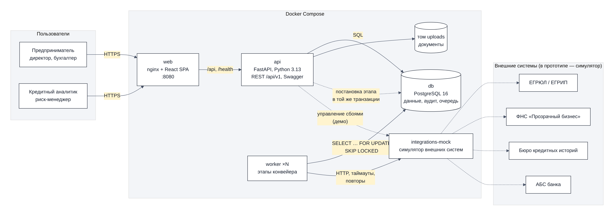
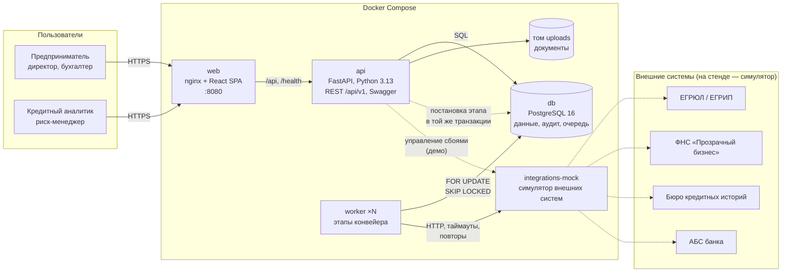

# Архитектура

## Компоненты

| Компонент | Технологии | Ответственность |
|---|---|---|
| `web` | React 19, TypeScript, Vite, TanStack Query; nginx | кабинет клиента и рабочее место банка в одном веб-интерфейсе с ролями; оформление в духе цифровых продуктов Альфа-Банка (шрифт Golos Text, без логотипа банка), вёрстка работает и на телефоне; nginx отдаёт статику и проксирует `/api` |
| `api` | Python 3.13, FastAPI, SQLAlchemy 2, Pydantic 2, Alembic | REST API, авторизация и права, машина состояний, документы, подпись, решения аналитика, конструктор условий, мониторинг; OpenAPI генерируется из кода |
| `worker` | тот же образ, `python -m app.worker.runner` | этапы конвейера: проверка полноты, сбор данных, скоринг, решение, выдача, истечение предложений |
| `db` | PostgreSQL 16 | заявки и справочники, журнал аудита, очередь этапов |
| `integrations-mock` | FastAPI | упрощённые контракты ЕГРЮЛ/ЕГРИП, ФНС, БКИ, АБС на синтетических данных; моделирование сбоев |

## Как заявка проходит конвейер

1. Клиент отправляет заявку: API в одной транзакции меняет статус, пишет событие в журнал и ставит этап `PRECHECK` в `pipeline_jobs`.
2. Воркер забирает этап через `SELECT … FOR UPDATE SKIP LOCKED`. Несколько воркеров не возьмут один этап дважды, поэтому их можно масштабировать: `docker compose up --scale worker=3`.
3. Каждый этап идемпотентен: сначала проверяет, что заявка в ожидаемом статусе (её могли отозвать), выполняет работу, переводит заявку дальше и ставит следующий этап.
4. Ошибка внешней системы — повтор с экспоненциальной паузой 2 → 4 → 8 → 16 с (до 5 попыток). Клиент видит понятный подшаг: «Бюро кредитных историй временно не отвечает — повторим запрос через 4 с». Ответ без обязательных данных — тоже ошибка: адаптер сверяет каждый ответ с контрактом (`backend/app/integrations/contracts.py`: обязательные поля, ИНН запрошенной компании, сумма выдачи) и не сохраняет неполный. Если попытки исчерпаны, заявка уходит аналитику с причиной, а не «зависает». Так же обрабатывается сбой проверки полноты, скоринга и расчёта решения: у каждого этапа есть обработчик на случай, когда попытки кончились.
5. Выдача повторяется дольше — до 30 попыток (пауза растёт до 30 с). Если АБС так и не ответила, заявка остаётся на выдаче и попадает в очередь специалиста с кнопкой «Повторить выдачу»: договор подписан, отменять его нельзя.
6. Интерфейс опрашивает API раз в 1–2 секунды, пока заявка в обработке, и показывает движение по конвейеру.

Конструктор условий (`backend/app/services/simulation.py`) в конвейер не входит: API синхронно пересчитывает решение той же моделью и политикой на уже полученных сведениях и ничего не записывает. Новая заявка на выбранных условиях проходит конвейер обычным путём.

## Enterprise-аспекты

### Безопасность

- **Аутентификация** — JWT (HS256, срок жизни настраивается). Токен без срока действия, пользователя или издателя не принимается. Вне демо-режима API не стартует с секретом подписи по умолчанию. В рабочей версии кабинет встраивается в интернет-банк и получает пользователя через SSO (OAuth 2.0 / OpenID Connect). Предприниматель уже клиент банка, поэтому отдельная регистрация не нужна.
- **Авторизация** — роли (`CLIENT`, `ANALYST`, `RISK_MANAGER`) и проверка доступа на уровне записи: клиент видит только заявки своих компаний. Чужая заявка возвращает 404, а не 403, чтобы не раскрывать её существование. Банк видит только отправленные заявки: черновик, даже отменённый, — это данные клиента без подписанных согласий. Параметры политики меняет только риск-менеджер.
- **Полномочия внутри компании.** Подписывать согласия и договор, выбирать условия, отказываться от предложения и отзывать отправленную заявку может только представитель с правом подписи. Бухгалтер готовит заявку и передаёт её руководителю кнопкой «Передать на подпись».
- **Подпись** — одноразовый 6-значный код, хранится только хеш с солью, 5 минут жизни, не больше 5 попыток ввода и 10 кодов за 10 минут.
- **Пароли и подбор** — PBKDF2-SHA256, 210 000 итераций. Сравнение кодов и хешей — в постоянное время; для несуществующего логина пароль тоже проверяется, чтобы время ответа не выдавало, есть ли такой пользователь. Ограничения за 10 минут: 10 неудачных входов по логину с одного адреса закрывают вход по нему только с этого адреса — чужой адрес не заблокирует пользователя, который входит со своего; 50 неудачных входов по логину со всех адресов и 100 с одного адреса по любым логинам тоже дают 429. Попытки по одному логину проверяются по очереди (advisory-блокировка PostgreSQL), поэтому параллельные запросы лимит не обходят. Перед API nginx пропускает не больше 20 запросов входа в минуту с адреса. Попытки входа пишутся в `login_attempts`. Конструктор условий (`POST …/simulation`, до десятка прогонов политики за запрос) nginx тоже ограничивает: 3 расчёта в секунду с адреса, пачкой — до 30 (интерфейс шлёт не чаще раза в 350 мс), чтобы скрипт с токеном не мог занять API расчётами. В рабочей версии вход идёт через SSO банка, где эти меры дополняет капча.
- **Документы** — проверка формата по содержимому файла (сигнатура PDF, PNG, JPEG, Office), размера (до 10 МБ) и количества (до 20 на заявку). Имя файла на диске случайное; в имени для скачивания удаляются управляющие и «невидимые» символы, а расширение берётся из проверенного формата. Защита от выхода за пределы хранилища, SHA-256 для контроля целостности. Файл удаляется из хранилища после фиксации в БД и только если на него не ссылается ни одна заявка; если файла нет — понятная ошибка 404, а не 500.
- **Ввод** — у всех полей API ограничены длина и диапазон значений; символ NUL отклоняется (422), а не роняет запрос. Ошибка валидации возвращается списком понятных сообщений на русском (422), стандартные ответы фреймворка тоже переведены. Непредвиденная ошибка — ответ 500 с `request_id` без технических подробностей. Параметры SQL-запросов в логи не попадают.
- **Веб** — заголовки безопасности в nginx; на страницах интерфейса — Content-Security-Policy (скрипты, шрифты и запросы — только со своего адреса, встроить страницу в чужой сайт нельзя) и Permissions-Policy (без камеры, микрофона и геолокации). Swagger (`/api/docs`) берёт скрипты с CDN, поэтому CSP на него не распространяется. Ограниченный CORS; адрес клиента nginx берёт из соединения и не пропускает присланный клиентом `X-Forwarded-For`. `X-Request-ID` от клиента принимается, только если похож на идентификатор, — и в nginx, и в API. Секреты передаются только через переменные окружения.
- **Демо-режим** (`DEMO_MODE`) — демо-учётки, код подписи в окне подписи, примеры документов и моделирование сбоев работают только в нём. При `DEMO_MODE=false` эти функции отвечают 404, демо-пользователи не создаются, а при старте API отключаются учётки с логином из демо-данных и общеизвестным паролем — при возврате в демо-режим они снова включаются, учётку с тем же логином и своим паролем это не затрагивает. Код подписи должен доставлять канал банка (в этой сборке он не подключён).
- **Аудит** — смены статуса, подписи, загрузка и удаление документов, запросы и решения аналитика записываются в `application_events` с автором и временем; вызовы внешних систем — в `integration_calls`, попытки входа — в `login_attempts`.

### Надёжность и отказоустойчивость

- Повторы с экспоненциальной паузой и журнал вызовов внешних систем (`integration_calls`) с корреляционным ID.
- Этап с упавшего воркера возвращается в очередь: если он «висит» в RUNNING дольше 5 минут, воркер-уборщик снимает блокировку. Этап, на котором воркеры погибали уже все отведённые попытки (например, задача исчерпывает память), в очередь не возвращается — он отмечается как невыполненный, и заявка уходит специалисту с причиной «технический сбой», как и после ошибки с исчерпанными повторами. Так одна «ядовитая» задача не крутится в очереди вечно.
- Заявку на автоматическом этапе, у которого последняя задача упала и не повторяется (например, сбой случился до появления обработчика), тот же уборщик передаёт специалисту с причиной «технический сбой».
- Выдача идемпотентна: ключ идемпотентности — ID заявки, поэтому повтор не создаст второй кредит. Если АБС недоступна дольше всех попыток, заявка ждёт в очереди специалиста, и он повторяет выдачу одной кнопкой.
- Воркер переживает изменения заявки во время этапа: если её отозвали или взяли в работу, пока этап ждал ответа внешней системы, ошибка сохраняется на свежей версии заявки, а подсказка «временно не отвечает» показывается, только пока заявка на этом этапе. Ошибка этапа не останавливает воркер.
- Двойные нажатия и параллельные запросы не ломают данные: подпись, выдача кодов, загрузка документов, повторная подача и повтор этапа выполняются под advisory-блокировкой по заявке, у согласий — ограничение уникальности в БД.
- Замена заявки новой (`reapply` с `replace_current`) — одна транзакция: отказ от предложения или отзыв выполняются вместе с созданием черновика, а при ошибке в условиях исходная заявка не меняется. Сервер сверяет статус, который видел клиент: если заявка успела измениться (например, специалист её одобрил), ничего не закрывается.
- Оптимистичная блокировка заявки: одновременные изменения не перезаписывают друг друга.
- Healthcheck у всех контейнеров: у API и симулятора — HTTP-проверка, у воркера — свежесть файла-пульса, который он обновляет, пока работает с очередью в БД. `restart: unless-stopped`, корректная остановка воркера по SIGTERM (дорабатывает текущий этап).
- Предложение и выбранный вариант действуют ограниченное время: воркер закрывает просроченные заявки, а договор по истёкшему предложению не подписывается.
- На дашборде можно отключить или замедлить любую внешнюю систему или заставить её отвечать пустым ответом и посмотреть, как ведёт себя конвейер.
- Принятие предложения перепроверяет долговую нагрузку компании под advisory-блокировкой по компании: параллельные принятия по разным заявкам не обходят ограничение 40%. Решение специалиста проверяет то же ограничение.
- Отправка черновика сверяет условия из формы клиента с сохранёнными: если автосохранение не дошло до банка, заявка не уходит на других условиях.

### Масштабирование

- API и воркеры не хранят состояние: их можно запускать в нескольких экземплярах за балансировщиком.
- Нагрузка на БД — индексы по статусу, компании, очереди этапов; кеш ответов источников на 24 часа; реестр банка загружает скоринг и решения пакетно, без запроса на каждую строку.
- При росте нагрузки очередь в PostgreSQL заменяется брокером (Kafka или RabbitMQ) без изменения логики этапов: интерфейс «взять этап → выполнить → поставить следующий» сохраняется.

### Наблюдаемость

- Структурированные JSON-логи (API и воркер) с `request_id`, номером заявки, этапом и длительностью — готовы для ELK или Loki.
- Метрики Prometheus на `/metrics` API (порт 8000; через nginx наружу не публикуются): число и длительность HTTP-запросов по маршрутам, глубина очереди этапов по статусам.
- `/health/live` и `/health/ready` (проверка БД) — для оркестратора.
- Дашборд банка: воронка, доля автоматических решений, время до решения и выдачи, очередь ручного рассмотрения и SLA, ошибки и задержки внешних систем.

### Сопровождение

- Доменная логика (скоринг, политика, продукты, машина состояний) отделена от транспорта и БД и покрыта модульными тестами.
- Версии модели и политики сохраняются в каждом решении. Изменение правил не меняет задним числом объяснение старых решений.
- Ключевая ставка меняется в интерфейсе риск-менеджера без релиза.
- Миграции схемы (Alembic), зафиксированные зависимости с хешами (`requirements.txt`, `package-lock.json`), CI в GitHub Actions: линтер, тесты, сборка, запуск в Docker, сквозные сценарии. Там же проверка зависимостей и образов на известные уязвимости: `pip-audit` по lock-файлам Python, `npm audit` для интерфейса, Trivy для трёх Docker-образов (критические уязвимости с исправлением останавливают сборку, высокие — в отчёте).
- Публикация на сервере — тот же Compose за Caddy ([deploy/](../deploy/README.md)). Caddy выпускает и продлевает сертификат Let's Encrypt. Наружу открыты только порты 80 и 443. nginx берёт адрес посетителя из заголовка, только если тот пришёл от Caddy, поэтому ограничения частоты входа работают для каждого посетителя.

## Путь к промышленной версии

| Сейчас | В рабочей версии |
|---|---|
| вход по демо-учёткам | SSO интернет-банка для бизнеса (OIDC), сессия из ДБО |
| симулятор ЕГРЮЛ/ФНС | СМЭВ, API ФНС, коммерческие агрегаторы данных о контрагентах |
| симулятор БКИ | интеграция с несколькими БКИ по согласию (218-ФЗ) |
| код подтверждения в окне подписи (демо-режим) | подпись в ДБО, УКЭП или Госключ |
| симулятор АБС | интеграция с АБС через шину предприятия (ESB) |
| очередь в PostgreSQL | брокер сообщений, оркестрация процесса (BPMN-движок), если этапов станет больше |
| балльная модель | статистическая или ML-модель из реестра моделей, с мониторингом качества |
| том Docker для файлов | S3-совместимое хранилище с шифрованием и сроками хранения |
| синтетические данные | данные клиента из корпоративного хранилища (DWH) |
