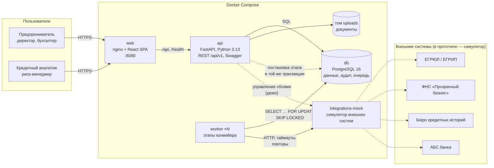

# Архитектура

## Компоненты

| Компонент | Технологии | Ответственность |
|---|---|---|
| `web` | React 19, TypeScript, Vite, TanStack Query; nginx | кабинет клиента и рабочее место банка в одном веб-интерфейсе с ролями; nginx отдаёт статику и проксирует `/api` |
| `api` | Python 3.13, FastAPI, SQLAlchemy 2, Pydantic 2, Alembic | REST API, авторизация и права, машина состояний, документы, подпись, решения аналитика, мониторинг; OpenAPI генерируется из кода |
| `worker` | тот же образ, `python -m app.worker.runner` | этапы конвейера: проверка полноты, сбор данных, скоринг, решение, выдача, истечение предложений |
| `db` | PostgreSQL 16 | заявки и справочники, журнал аудита, очередь этапов |
| `integrations-mock` | FastAPI | упрощённые контракты ЕГРЮЛ/ЕГРИП, ФНС, БКИ, АБС на синтетических данных; моделирование сбоев |

## Как заявка проходит конвейер

1. Клиент отправляет заявку: API в одной транзакции меняет статус, пишет событие в журнал и ставит этап `PRECHECK` в `pipeline_jobs`.
2. Воркер забирает этап через `SELECT … FOR UPDATE SKIP LOCKED`. Несколько воркеров не возьмут один этап дважды, поэтому их можно масштабировать: `docker compose up --scale worker=3`.
3. Каждый этап идемпотентен: сначала проверяет, что заявка в ожидаемом статусе (её могли отозвать), выполняет работу, переводит заявку дальше и ставит следующий этап.
4. Ошибка внешней системы — повтор с экспоненциальной паузой 2 → 4 → 8 → 16 с (до 5 попыток). Клиент видит понятный подшаг: «Бюро кредитных историй временно не отвечает — повторим запрос через 4 с». Если попытки исчерпаны, заявка уходит аналитику с причиной, а не «зависает».
5. Интерфейс опрашивает API раз в 1–2 секунды, пока заявка в обработке, и показывает движение по конвейеру.

## Enterprise-аспекты

### Безопасность

- **Аутентификация** — JWT (HS256, срок жизни настраивается). В рабочей версии кабинет встраивается в интернет-банк и получает пользователя через SSO (OAuth 2.0 / OpenID Connect). Предприниматель уже клиент банка, поэтому отдельная регистрация не нужна.
- **Авторизация** — роли (`CLIENT`, `ANALYST`, `RISK_MANAGER`) и проверка доступа на уровне записи: клиент видит только заявки своих компаний. Чужая заявка возвращает 404, а не 403, чтобы не раскрывать её существование.
- **Полномочия внутри компании.** Подписывать согласия и договор, выбирать условия, отказываться от предложения и отзывать отправленную заявку может только представитель с правом подписи. Бухгалтер готовит заявку и передаёт её руководителю кнопкой «Передать на подпись».
- **Подпись** — одноразовый 6-значный код, хранится только хеш с солью, 5 минут жизни, не больше 5 попыток ввода и 10 кодов за 10 минут.
- **Пароли** — PBKDF2-SHA256, 210 000 итераций. Сравнение кодов и хешей — в постоянное время. После 10 неудачных попыток входа подряд вход по этому логину закрыт на 10 минут; попытки входа пишутся в `login_attempts`.
- **Документы** — проверка формата по содержимому файла (сигнатура PDF, PNG, JPEG, Office), размера (до 10 МБ), имя файла на диске случайное, защита от выхода за пределы хранилища, SHA-256 для контроля целостности.
- **Ввод** — у всех полей API ограничены длина и диапазон значений; ошибка валидации возвращается списком понятных сообщений (422), непредвиденная — ответом 500 с `request_id` без технических подробностей.
- **Веб** — заголовки безопасности в nginx, ограниченный CORS. Секреты передаются только через переменные окружения.
- **Аудит** — смены статуса, подписи, загрузка и удаление документов, запросы и решения аналитика записываются в `application_events` с автором и временем; вызовы внешних систем — в `integration_calls`, попытки входа — в `login_attempts`.

### Надёжность и отказоустойчивость

- Повторы с экспоненциальной паузой и журнал вызовов внешних систем (`integration_calls`) с корреляционным ID.
- Этап с упавшего воркера возвращается в очередь: если он «висит» в RUNNING дольше 5 минут, воркер-уборщик снимает блокировку.
- Выдача идемпотентна: ключ идемпотентности — ID заявки, поэтому повтор не создаст второй кредит.
- Оптимистичная блокировка заявки: одновременные изменения не перезаписывают друг друга.
- Healthcheck у всех контейнеров: у API и симулятора — HTTP-проверка, у воркера — свежесть файла-пульса, который он обновляет, пока работает с очередью в БД. `restart: unless-stopped`, корректная остановка воркера по SIGTERM (дорабатывает текущий этап).
- Предложение и выбранный вариант действуют ограниченное время: воркер закрывает просроченные заявки, а договор по истёкшему предложению не подписывается.
- На дашборде можно отключить или замедлить любую внешнюю систему и посмотреть, как ведёт себя конвейер.

### Масштабирование

- API и воркеры не хранят состояние: их можно запускать в нескольких экземплярах за балансировщиком.
- Нагрузка на БД — индексы по статусу, компании, очереди этапов; кеш ответов источников на 24 часа; реестр банка загружает скоринг и решения пакетно, без запроса на каждую строку.
- При росте нагрузки очередь в PostgreSQL заменяется брокером (Kafka или RabbitMQ) без изменения логики этапов: интерфейс «взять этап → выполнить → поставить следующий» сохраняется.

### Наблюдаемость

- Структурированные JSON-логи (API и воркер) с `request_id`, номером заявки, этапом и длительностью — готовы для ELK или Loki.
- Метрики Prometheus на `/metrics` API (порт 8000; через nginx наружу не публикуются): число и длительность HTTP-запросов по маршрутам, глубина очереди этапов по статусам.
- `/health/live` и `/health/ready` (проверка БД) — для оркестратора.
- Дашборд банка: воронка, доля автоматических решений, время до решения и выдачи, очередь ручного рассмотрения и SLA, ошибки и задержки внешних систем.

### Сопровождение

- Доменная логика (скоринг, политика, продукты, машина состояний) отделена от транспорта и БД и покрыта модульными тестами.
- Версии модели и политики сохраняются в каждом решении. Изменение правил не меняет задним числом объяснение старых решений.
- Ключевая ставка меняется в интерфейсе риск-менеджера без релиза.
- Миграции схемы (Alembic), зафиксированные зависимости с хешами (`requirements.txt`, `package-lock.json`), CI в GitHub Actions: линтер, тесты, сборка, запуск в Docker, сквозные сценарии.

## Путь к промышленной версии

| В прототипе | В рабочей версии |
|---|---|
| вход по демо-учёткам | SSO интернет-банка для бизнеса (OIDC), сессия из ДБО |
| симулятор ЕГРЮЛ/ФНС | СМЭВ, API ФНС, коммерческие агрегаторы данных о контрагентах |
| симулятор БКИ | интеграция с несколькими БКИ по согласию (218-ФЗ) |
| код подтверждения в окне | подпись в ДБО, УКЭП или Госключ |
| симулятор АБС | интеграция с АБС через шину предприятия (ESB) |
| очередь в PostgreSQL | брокер сообщений, оркестрация процесса (BPMN-движок), если этапов станет больше |
| балльная модель | статистическая или ML-модель из реестра моделей, с мониторингом качества |
| том Docker для файлов | S3-совместимое хранилище с шифрованием и сроками хранения |
| синтетические данные | данные клиента из корпоративного хранилища (DWH) |
