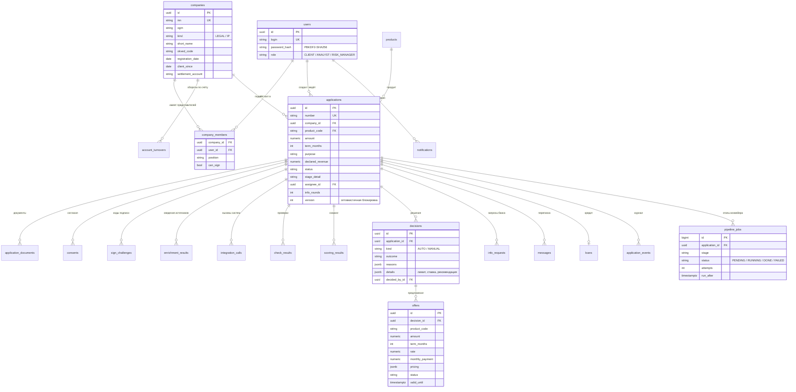

# Модель данных

PostgreSQL 16. Схема создаётся миграциями Alembic (`backend/migrations`), ORM-модели — `backend/app/models.py`. Денежные суммы хранятся в `NUMERIC(18,2)`, время — в `timestamptz`, гибкие структуры (ответы источников, факторы скоринга, расчёты) — в `JSONB`.

## Таблицы

| Таблица | Назначение | Важные поля |
|---|---|---|
| `users` | пользователи: представители клиентов и сотрудники банка | `role`, `password_hash` |
| `companies` | клиенты банка (ИП и юрлица), данные уже известны банку | `inn`, `ogrn`, `kind`, `client_since`, `settlement_account` |
| `company_members` | кто представляет компанию и может ли подписывать | `position`, `can_sign` |
| `account_turnovers` | внутренние данные банка: обороты по счёту помесячно | `credit_turnover`, `debit_turnover`, `avg_balance` |
| `products` | каталог продуктов и их параметры (ставки, лимиты, правила документов) | `base_spread`, `max_spread`, `turnover_multiplier`, `auto_decision_limit`, `doc_rules` |
| `settings` | параметры политики, которые меняются без релиза | `key_rate`, `key_rate_note` |
| `applications` | заявка: параметры, статус, подшаг, SLA, исполнитель | `status`, `stage_detail`, `review_due_at`, `version` |
| `application_documents` | файлы клиента (хранятся в томе `uploads`) | `doc_type`, `sha256`, `storage_key` |
| `consents` | согласия на запрос в БКИ и обработку данных | `consent_type`, `signed_by_id`, `signed_at`, `signature_ref` |
| `sign_challenges` | одноразовые коды простой ЭП (хранится только хеш) | `purpose`, `code_hash`, `expires_at`, `attempts` |
| `enrichment_results` | ответы источников, использованные в оценке (кеш на 24 ч) | `source` (EGRUL/FNS/BKI/INTERNAL), `payload` |
| `integration_calls` | журнал вызовов внешних систем | `service`, `status`, `duration_ms`, `attempt`, `correlation_id` |
| `check_results` | результаты проверки полноты по прогонам | `code`, `severity`, `run_id` |
| `scoring_results` | балл, рейтинг, PD, вклад факторов, метрики | `score`, `grade`, `factors`, `metrics`, `model_version` |
| `decisions` | все решения: автоматические и ручные, с причинами и расчётами | `kind`, `outcome`, `reasons`, `details`, `policy_version` |
| `offers` | варианты условий для клиента | `amount`, `term_months`, `rate`, `pricing`, `status`, `valid_until` |
| `info_requests` | запросы банка и ответы клиента внутри заявки | `items`, `status`, `answer_comment` |
| `messages` | переписка клиента и банка по заявке | `author_role`, `text` |
| `loans` | выданные кредиты с графиком платежей | `contract_number`, `loan_account`, `schedule` |
| `application_events` | журнал аудита всех действий | `event_type`, `from_status`, `to_status`, `actor_type`, `client_visible` |
| `notifications` | уведомления в кабинете (вместо SMS и почты) | `user_id`, `is_read` |
| `pipeline_jobs` | очередь этапов конвейера для воркеров | `stage`, `status`, `attempts`, `run_after`, `locked_by` |

## Решения, важные для банковской разработки

- **Оптимистичная блокировка** (`applications.version`). Если клиент и воркер одновременно меняют заявку, второй получит конфликт (HTTP 409 или повтор этапа), а не перезапишет данные.
- **Полный аудит.** Каждое изменение статуса и каждое действие пользователя попадает в `application_events`. Решения хранятся неизменяемыми записями с версией модели и политики (`model_version`, `policy_version`).
- **Хранение секретов.** Пароли — PBKDF2-SHA256 (210 000 итераций), коды подписи — только хеш с солью, токены не хранятся.
- **Персональные данные.** Хранятся только данные, нужные для решения, ссылки на согласия — в `consents`. В логах нет ПДн: только идентификаторы заявок и технические поля.
- **Очередь в той же БД.** Этап конвейера ставится в очередь в той же транзакции, что и смена статуса, поэтому этап не потеряется и не запустится для неподтверждённого статуса.
