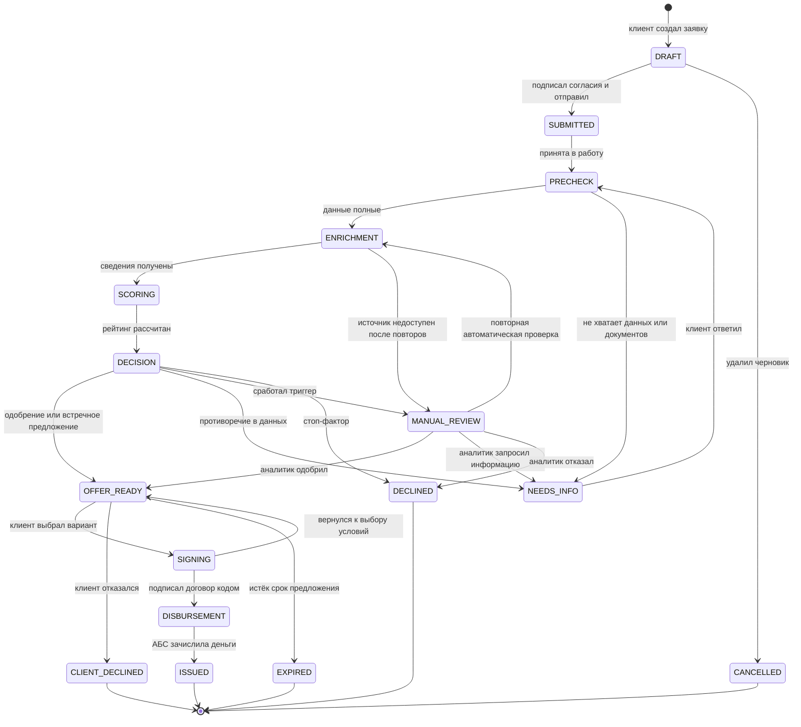

# Диаграмма состояний заявки

Переходы реализованы машиной состояний в `backend/app/domain/statuses.py`. Недопустимый переход отклоняется (HTTP 409). Каждый переход пишется в журнал `application_events`: кто, когда, из какого статуса в какой.

Отозвать заявку (`→ CANCELLED`) клиент может из любого статуса до решения: SUBMITTED, PRECHECK, NEEDS_INFO, ENRICHMENT, SCORING, DECISION, MANUAL_REVIEW. На диаграмме эти переходы не показаны, чтобы её можно было читать.

## Статусы

| Статус | Для банка | Для клиента | Кто переводит дальше |
|---|---|---|---|
| DRAFT | Черновик | Черновик | клиент |
| SUBMITTED | Подана | Отправлена | система (сразу) |
| PRECHECK | Проверка полноты | Проверяем данные | воркер |
| NEEDS_INFO | Запрошена информация | Нужны уточнения | клиент |
| ENRICHMENT | Сбор данных | Собираем сведения | воркер |
| SCORING | Скоринг | Оцениваем заявку | воркер |
| DECISION | Решение | Готовим решение | воркер |
| MANUAL_REVIEW | Ручное рассмотрение | У кредитного специалиста | аналитик |
| OFFER_READY | Предложение у клиента | Готово предложение | клиент / таймер |
| SIGNING | Подписание | Подписание договора | клиент (подписант) |
| DISBURSEMENT | Выдача | Перечисляем деньги | воркер |
| ISSUED | Выдан | Кредит выдан | — |
| DECLINED | Отказ | Отказ | — |
| CLIENT_DECLINED | Отказ клиента | Вы отказались от предложения | — |
| CANCELLED | Отменена | Заявка отозвана | — |
| EXPIRED | Предложение истекло | Срок предложения истёк | — |

Клиент видит пять крупных шагов «конвейера»: **Заявка → Проверка и оценка → Предложение → Подписание → Выдача**. Для каждого статуса показывается, что происходит сейчас и что делать дальше. Подробный внутренний статус и текущий подшаг (например, «Запрашиваем кредитную историю в БКИ») приходят в поле `stage_detail` и обновляются в интерфейсе каждые 1–2 секунды.

## Данные при переходах не теряются

- Запрос информации и ответ клиента — в той же заявке (`info_requests`). После ответа заявка снова проходит конвейер, а уже полученные сведения из источников переиспользуются 24 часа (`enrichment_results`).
- Каждое решение (автоматическое и ручное) сохраняется отдельной записью в `decisions` вместе с причинами и расчётами.
- Новая заявка после отказа или истечения срока создаётся копированием (`parent_id` указывает на исходную).
