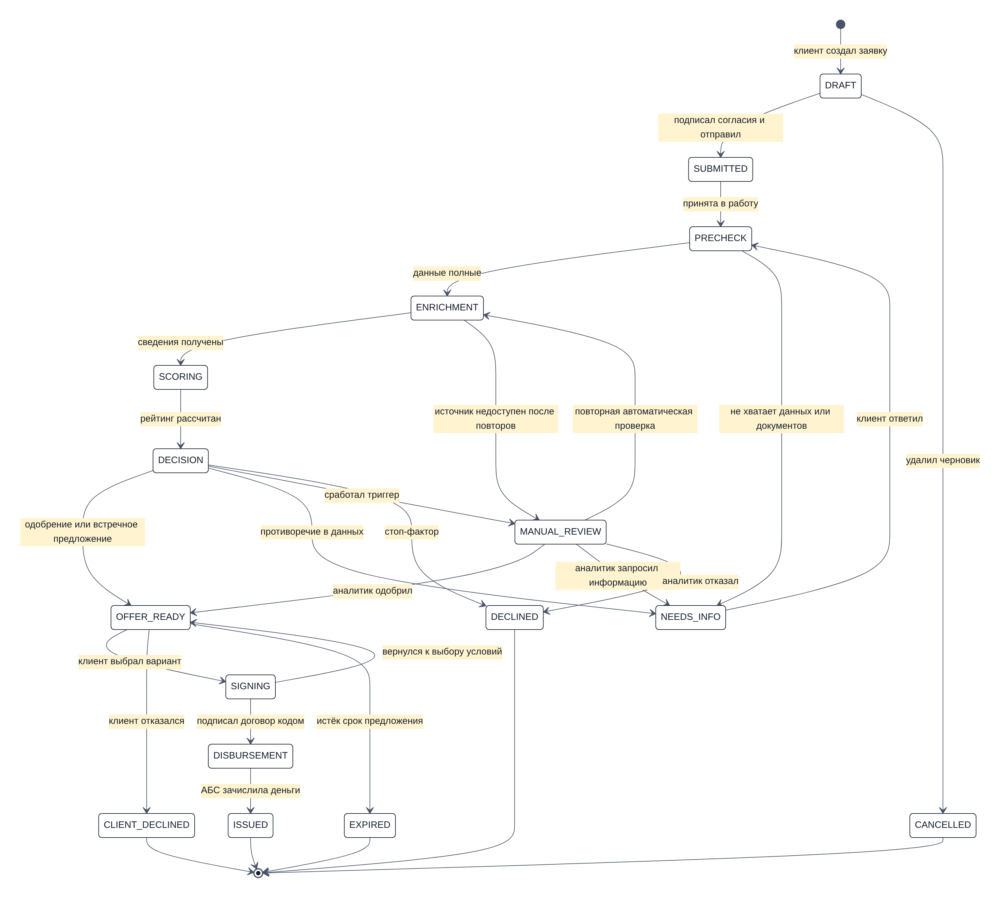
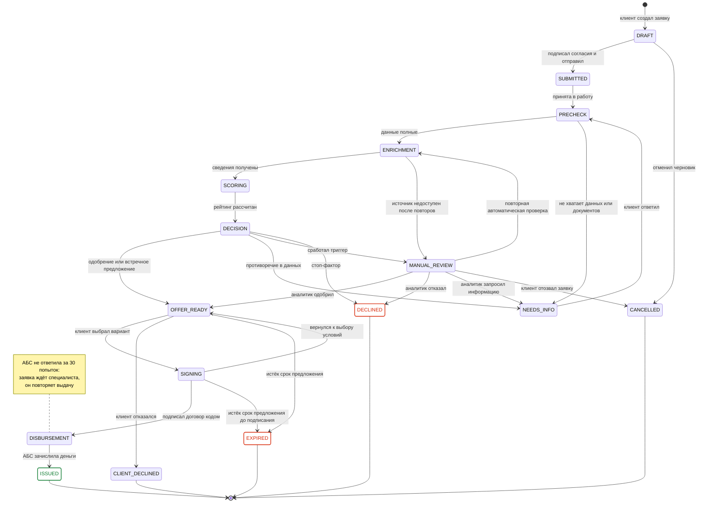

# Диаграмма состояний заявки

Переходы реализованы машиной состояний в `backend/app/domain/statuses.py`. Недопустимый переход отклоняется (HTTP 409). Каждый переход пишется в журнал `application_events`: кто, когда, из какого статуса в какой.

Зелёным отмечен успешный итог (кредит выдан), красным — отказ банка и истёкшее предложение; отзыв и отказ клиента — нейтральные, как в интерфейсе.

Отозвать заявку (`→ CANCELLED`) клиент может из любого статуса до решения: SUBMITTED, PRECHECK, NEEDS_INFO, ENRICHMENT, SCORING, DECISION, MANUAL_REVIEW. На диаграмме показаны только отмена черновика и отзыв с ручного рассмотрения, остальные переходы опущены, чтобы её можно было читать. Отзывает заявку представитель с правом подписи; свой черновик может отменить и его автор (например, бухгалтер). После решения банка заявку не отзывают, а отказываются от предложения; после подписания договора её уже нельзя ни отозвать, ни отменить.

Предложение действует до даты в нём (`OFFER_VALID_DAYS`, по умолчанию 10 дней). Выбранный вариант действует до той же даты: если договор не подписан вовремя, воркер переводит заявку в EXPIRED, а подписать договор по истёкшему предложению нельзя (HTTP 409). Отказ от уже истёкшего предложения тоже закрывает заявку как EXPIRED.

Выдача повторяется автоматически до 30 раз с растущей паузой (до 30 с между попытками). Если АБС так и не ответила, заявка остаётся в статусе DISBURSEMENT: договор подписан, и отменить его нельзя. Клиент видит «Выдача задерживается: учётная система банка не ответила вовремя», а заявка попадает в очередь специалиста с причиной «Выдача не прошла — повторите её, когда АБС снова доступна». Специалист нажимает «Повторить выдачу»; запрос в АБС идемпотентен, второго кредита не будет.

## Статусы

| Статус | Для банка | Для клиента | Кто переводит дальше |
|---|---|---|---|
| DRAFT | Черновик | Черновик | клиент |
| SUBMITTED | Подана | Отправлена | система (сразу) |
| PRECHECK | Проверка полноты | Проверяем данные | воркер |
| NEEDS_INFO | Запрошена информация | Нужны уточнения | клиент |
| ENRICHMENT | Сбор данных | Собираем сведения | воркер |
| SCORING | Скоринг | Оцениваем заявку | воркер |
| DECISION | Решение | Готовим решение | воркер |
| MANUAL_REVIEW | Ручное рассмотрение | У кредитного специалиста | аналитик |
| OFFER_READY | Предложение у клиента | Готово предложение | клиент (подписант) / таймер |
| SIGNING | Подписание | Подписание договора | клиент (подписант) / таймер |
| DISBURSEMENT | Выдача | Перечисляем деньги (овердрафт — «Подключаем овердрафт») | воркер; после сбоя АБС — специалист |
| ISSUED | Выдан | Кредит выдан (овердрафт — «Овердрафт подключён») | — |
| DECLINED | Отказ | Отказ | — |
| CLIENT_DECLINED | Отказ клиента | Вы отказались от предложения | — |
| CANCELLED | Отменена | Заявка отозвана (неотправленный черновик — «Черновик отменён») | — |
| EXPIRED | Предложение истекло | Срок предложения истёк | — |

Клиент видит пять крупных шагов «конвейера»: **Заявка → Проверка и оценка → Предложение → Подписание → Выдача**. Для каждого статуса показывается, что происходит сейчас и что делать дальше. Отказ банка и истёкшее предложение отмечены как отрицательный итог, а отзыв заявки и отказ от предложения — нейтрально: это решение клиента, а не отказ банка. У отменённого черновика — шаг «Заявка», рассмотрение не начиналось. Подробный внутренний статус и текущий подшаг (например, «Запрашиваем кредитную историю в БКИ») приходят в поле `stage_detail` и обновляются в интерфейсе каждые 1–2 секунды.

## Новая заявка на других условиях

Конструктор условий ([decision-logic.md](decision-logic.md#конструктор-условий)) не меняет текущую заявку, а создаёт новую — черновик DRAFT со ссылкой `parent_id` на исходную. Если выбранные условия совпадают с вариантом из предложения банка, новая заявка не нужна: «Выбрать этот вариант» переводит текущую заявку в SIGNING, как и выбор варианта в самом предложении.

| Исходная заявка | Что происходит с ней | Что получается |
|---|---|---|
| OFFER_READY | клиент подтверждает замену; отказ от предложения и новый черновик — одна операция (`reapply` с `replace_current`) → CLIENT_DECLINED, а если предложение уже истекло — EXPIRED | новый черновик на выбранных условиях |
| MANUAL_REVIEW | клиент подтверждает замену; отзыв и новый черновик — одна операция → CANCELLED | новый черновик на выбранных условиях |
| DECLINED, CLIENT_DECLINED, EXPIRED, CANCELLED | уже закрыта | новый черновик из конструктора на выбранных условиях; если конструктор недоступен (стоп-фактор, отказ специалиста) — кнопкой «Подать новую заявку с этими данными» на тех же условиях |

Если в условиях ошибка, операция не выполняется целиком: исходная заявка остаётся в прежнем статусе. Так же, если заявка успела измениться, пока клиент выбирал условия (например, специалист её одобрил): интерфейс передаёт статус, который видел клиент (`expected_status`), и при расхождении ничего не закрывается. Заменять заявку ради тех же условий или варианта из предложения банка нельзя. В истории исходной заявки появляется «Создана новая заявка № …». Заменить заявку с предложением или на рассмотрении может только подписант. Сотрудник без права подписи передаёт условия руководителю («Передать руководителю»): статус заявки не меняется, а у руководителя эти условия открываются в конструкторе, пока по ним не подана новая заявка.

По одной исходной заявке может быть только одна незакрытая новая. Пока она есть, в исходной заявке показывается ссылка на неё (`next_application`), а повторная подача возвращает 409. Если по заявке отказал кредитный специалист, конструктора у неё нет, а новые заявки компании в течение 90 дней уходят на ручное рассмотрение.

## Данные при переходах не теряются

- Запрос информации и ответ клиента — в той же заявке (`info_requests`). После ответа заявка снова проходит конвейер, а уже полученные сведения из источников переиспользуются 24 часа (`enrichment_results`).
- Каждое решение (автоматическое и ручное) сохраняется отдельной записью в `decisions` вместе с причинами и расчётами.
- Новая заявка после отказа, отзыва или истечения срока создаётся со ссылкой на исходную (`parent_id`): параметры или новые условия из конструктора, описание задачи, выручка, залог, поручительство и документы переносятся. Документы — ссылкой на тот же файл, без копирования. Согласия подписываются заново.
